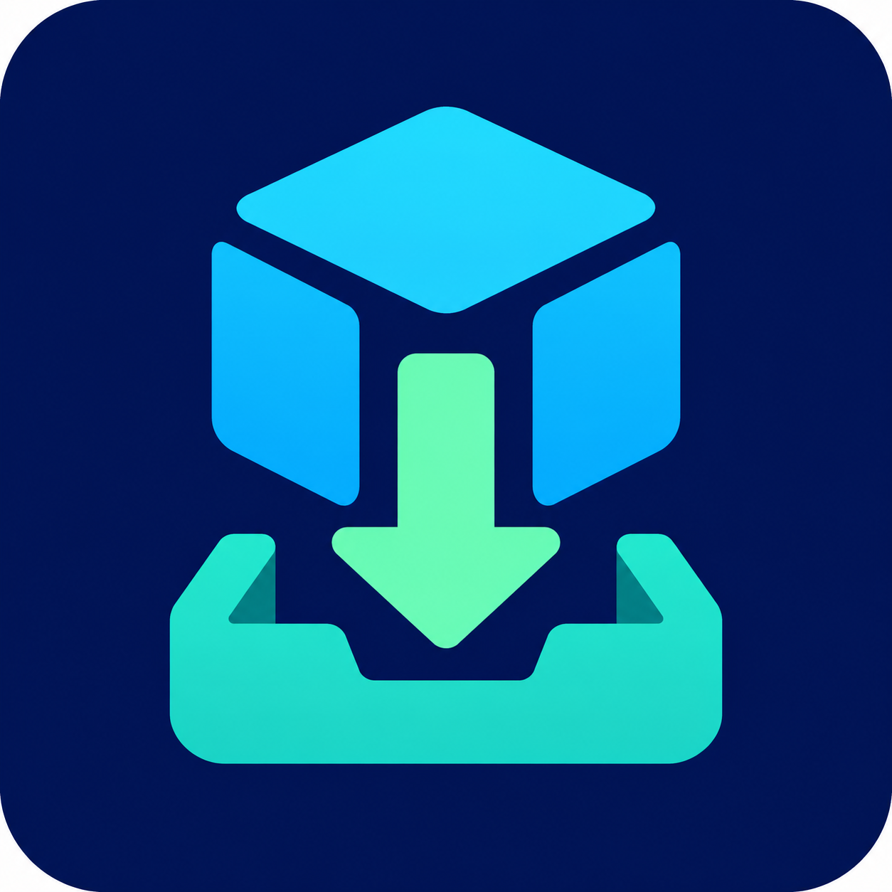

# Local Install Center

A graphical, user-level software installer for Linux Mint and other Linux desktops. It helps install supported apps without opening a terminal or using administrator privileges.



## Version 0.4

- Keeps the main install action visible in a fixed bottom bar, even when the window is short. Tab content scrolls when needed.
- Adds an app icon to the window and application-menu launcher.
- Adds an **Installed apps** page for user Flatpaks: refresh the list, launch an app, uninstall it while retaining its data, or update user Flatpaks.
- Adds **Install update…**. Choose a downloaded Local Install Center archive; the app checks its release metadata, archive paths and file types, required files, and Python syntax before switching the menu launcher. Previous releases stay in separate folders.
- Sets up the official Flathub remote for the current user when needed.
- Keeps install output and progress visible in the Activity area.

## Install

1. Download a release archive and extract it in Nemo.
2. Double-click `Setup-Local-Install-Center.sh` and choose **Run** if prompted.
3. Open **Local Install Center** from the application menu.

The setup copies the release under `~/.local/share/local-install-center/releases/` and adds a user-level menu entry. It requires Python 3 with Tkinter. Setup and the app do not use `sudo`.

For an update, open Local Install Center, click **Install update…**, choose the newer release archive, confirm, and restart the app from the menu. The updater does not delete older release folders. Its consistency checks do not authenticate who published the archive, so only install releases you trust.

## Supported install methods

### AppImage

Give the app name and a direct HTTPS link to an `.AppImage` file. An optional SHA-256 lets you compare the download with a value obtained from a trusted publisher. The file is saved under `~/.local/opt/local-install-center/`, marked executable, and given a menu shortcut.

### Flatpak

Enter a Flathub app ID such as `org.inkscape.Inkscape`, select `flathub`, then use the fixed bottom **Install Flatpak** button. Installation is per-user. If Flathub is missing from the user's Flatpak configuration, Local Install Center adds the official Flathub remote for that account first.

The **Installed apps** page lists user-installed Flatpaks and can launch, uninstall, or update them. Uninstall leaves app settings and data in the user's home folder.

### CLI packages

Uses an already installed `pipx`, `cargo`, or `npm` to install a named command-line package. Package install hooks can run code as your user; this feature is not a sandbox.

## Not supported

- `apt install` and `.deb` package installation: they normally change the system package database and system-owned files, which require administrator authorization.
- Generic `curl ... | sh` or arbitrary shell commands: scripts can do anything your user account can do, may request elevation, and cannot be reliably converted into a user-local install.
- Generic archive installation: file layouts and launch steps differ too much for a safe universal installer. A documented per-app installer can be added later.

No install method proves a download is safe. AppImages and package hooks run with the user's permissions. Local Install Center does not call `sudo`, but it is not a security sandbox and cannot prevent a downloaded program from attempting privileged actions.

## Run from source

```sh
python3 install_center.py
```

No third-party Python packages are required; the app uses Python's standard library and Tkinter.

## Manual test checklist

Test on a normal user account on Linux Mint or another supported Linux desktop. The app is designed not to need `sudo`.

1. Extract the release archive in Nemo, double-click `Setup-Local-Install-Center.sh`, choose **Run**, and confirm that **Local Install Center** appears in the application menu.
2. Open the app and make the window short. Check that the bottom install button and Activity area remain visible, then scroll each install page and confirm its fields remain reachable.
3. On the Flatpak page, install a small Flathub app you do not already have, using its exact app ID. Confirm Activity shows completion, then use **Installed apps** to refresh and launch it.
4. Use **Update my Flatpaks**, then uninstall only the test app. Check that its app data is retained, as the UI describes.
5. If testing AppImage, use a direct HTTPS AppImage link from the publisher and verify its SHA-256 when the publisher provides one. Confirm the saved file and menu shortcut, launch it, then remove the test app when finished.
6. If testing CLI packages, use a disposable package/tool environment and a package you trust. Package install hooks run with your user permissions.
7. When a newer Local Install Center archive is available, test **Install update…** and confirm it creates a new version folder, updates the menu launcher, and leaves earlier version folders in place.
8. Try an invalid app ID or URL and confirm the Activity area shows a useful error without freezing the window.

Avoid testing with apps or packages you cannot safely remove. Do not enter `sudo` commands or arbitrary shell scripts; those are intentionally outside the app's supported methods.

## Project status

This is an early project. It has not been visually checked on every Linux desktop or distribution. No license is included yet. Until a license is added, the source remains copyrighted by its author and users should not assume they may redistribute or modify it. Choose a license before inviting outside contributions.
